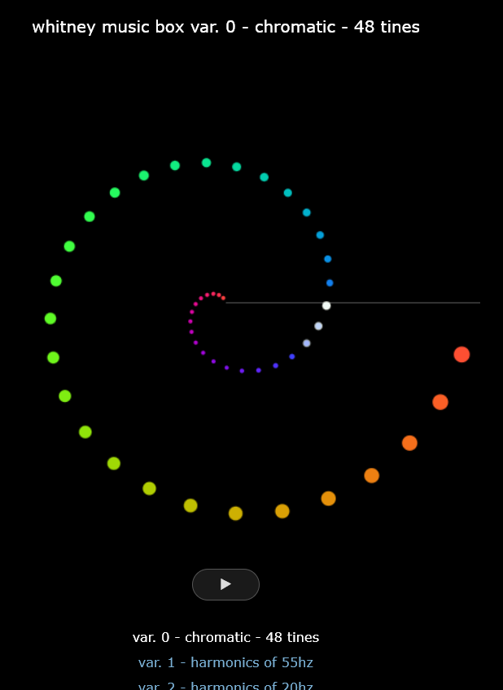

# Whitney Music Box — [HTML5 resurrection](https://erik-larsen.github.io/whitney-music-box/)

<p align="center"></p>

A faithful web port of the 21 Flash variations that lived at
[whitneymusicbox.org](https://whitneymusicbox.org) from 2006 until Flash died, along
with new variations including those from Whitney's book Digital Harmony.

- **Original music & animation:** [Jim Bumgardner](https://krazydad.com) (jbum), 2006
- **Concept:** John Whitney Sr., *Digital Harmony: On the Complementarity of Music
  and Visual Art* (1980); original BASIC examples by Paul Rother

## What this is

Each of the original `whitney*.swf` files contained:

1. **ActionScript 2 bytecode** — the incremental-drift animation (a variant of
   Jim's `whitney.as`), parameterized per variation (tine count, cycle length,
   stereo/sonar/sweep/crank quirks), and
2. **an embedded MP3 soundtrack** — a pre-rendered, exactly-3-minute loop
   (60 s for the Minute Waltz) played with `loops=32767`, with the animation
   free-running on a matching clock. The hand-cranked variation instead embeds
   26 individual reed samples triggered interactively.

This port:

- re-implements the recovered per-variation AS2 logic on a `<canvas>`
  (`js/whitney.js` — the variation manifest documents every recovered parameter),
- plays the **original soundtracks**, extracted byte-for-byte from the SWFs
  (`audio/*.mp3`), gaplessly looped via the Web Audio API with loop points set
  from each SWF's exact sample counts, and
- drives the animation from the audio clock, so picture and sound stay locked
  just like the original.

`compare.html` shows the port side-by-side with the original SWF running in
[Ruffle](https://ruffle.rs) for verification. The pristine SWFs are archived in
`originals/`; the Python scripts used to inventory the SWFs, extract the audio,
and disassemble the ActionScript are in `tools/`.

## Variations

| var | title | swf | tines | cycle | mode |
|----:|-------|-----|------:|------:|------|
| 0 | chromatic - 48 tines | whitneyChromatic | 48 | 180s | standard |
| 1 | harmonics of 55hz | whitneyHarmonic | 48 | 180s | standard |
| 2 | harmonics of 20hz | whitneyHarmonicLow | 48 | 180s | standard |
| 3 | harmonics of 48hz, reversed | whitneyHarmonicRev48 | 48 | 180s | standard |
| 4 | harmonics of 48hz, palindrome | whitneyPalindrome | 48 | 180s | standard |
| 5 | chromatic - 88 tines | whitney88 | 88 | 180s | standard |
| 6 | microtones | whitneyMTones | 48 | 180s | standard |
| 7 | harmonics - 120 tines, reversed | whitney120 | 120 | 180s | standard |
| 8 | chromatic - 88 organ pipes, rev. | whitney88b3 | 88 | 180s | standard |
| 9 | chromatic - 88 bars, rev. | whitney88bars | 88 | 180s | standard |
| 10 | chromatic - 64 pipe crypto calliope | whitney64Calliope | 64 | 180s | standard |
| 11 | minute waltz - 60 keys, 60 seconds | whitneyMinute | 60 | 60s | standard |
| 12 | chromatic - prime numbers only | whitneyPrimes | 48 | 180s | prime-number speeds |
| 13 | chromatic - non-primes only | whitneyNonPrimes | 48 | 180s | composite-number speeds |
| 14 | stereo | whitneyStereo | 48 | 180s | stereo (both-side line) |
| 15 | stereo - 120 | whitneyStereo120 | 120 | 180s | stereo |
| 16 | stereo - 210 | whitneyStereo210 | 210 | 180s | stereo |
| 17 | hand cranked | whitneyCrank | 25 | 60s | interactive crank, 25 reed samples |
| 18 | stereo drone (new) | whitneyStereoSweep | 50 | 180s | top-start, side pulses, pumpkin |
| 19 | stereo sonar (new) | whitneySonar | 48 | 180s | rotating sonar sweep line |
| 20 | bell carol (new) | whitneyCarol | 48 | 180s | standard (22 kHz soundtrack) |
| 21 | bells - pentatonic - 25 tines | — | 25 | 120s | synth only (2026) |
| 22 | reed organ - 25 tines | — | 25 | 60s | synth only (2026), original crank reed samples |
| 23 | column A - 60 falling columns | — | 59 voices | 90s | Digital Harmony (1980), synth only |
| 24 | column BC - the music box's ancestor | — | 359 voices | 540s | Digital Harmony (1980), granular microtone stream |
| 25 | arabesque | — | 359 voices | 720s | Digital Harmony (1980), microtone plucks |

## mp3 vs. synth — every variation, two ways

Each variation offers two sound sources, side by side in the variation list:

- **mp3** — the original 2006 soundtrack, extracted byte-for-byte from the SWF
  (11 kHz mono, exactly as it sounded in Flash), gaplessly looped.
- **synth** — a live Web Audio counterpart: every note is generated in the
  browser at its analytically exact trigger time (tine *j* at speed *s*
  revs/cycle crosses the line at `k·cycle/s`), scheduled ahead on the audio
  clock, sample-accurately. Voices and tunings echo each variation's original
  character — harmonic-series sines for the harmonics family (frequency =
  speed number × f0, Whitney's speed⇄harmonic identity made literal), plucks
  for the chromatic tine boxes, additive pipes for the organs/calliope, bells
  for bars and carol, panned dual-crossing triggers for the stereo family,
  slow overlapping swells for the drone, and meeting-point pings for the sonar.

## Digital Harmony reconstructions (1980)

Variations 23–25 reconstruct the graphics programs Paul Rother wrote for the
appendix of John Whitney's *Digital Harmony* (transcribed via Jim Bumgardner's
Processing ports in his Examples repo): **column A** (60 falling columns),
**column BC** (the spiral the Whitney Music Box animation is directly based
on), and **arabesque**. The book programs were visuals-only — note-triggered
sonification is Bumgardner's 2006 idea — so these apply his music-box
treatment to Whitney's own patterns: each element sounds as it wraps or
crosses its line, scheduled by the same live synth engine. Column A voices
all 59 moving columns chromatically; column BC and arabesque voice all 359
moving dots as quiet microtonal streams — at ~120 notes/s the individual
pings fuse into a granular wash that thickens and thins with the pattern's
alignments.

Variations 21+ are new, synth-only additions with no 2006 counterpart
(pentatonic bells, and a reed organ voiced by the 25 samples extracted from
the original hand-cranked SWF). Tunings (`chromatic`, `harmonics`,
`pentatonic`, `microtones`, plus `reverse`/`palindrome` flags) and voices
(`pluck`, `pure`, `bell`, `organ`, `pad`, `reed`) are parameterized in the
manifest in `js/whitney.js` — a new combination is one manifest line.

Notes on fidelity:

- "Reversed", "palindrome" and "microtone" variations differ **only in their
  soundtracks** — their ActionScript is byte-identical to the chromatic
  template. The character of each variation lives in the audio, which is the
  original recording.
- The primes/non-primes speed tables, the sonar's counterclockwise sweep
  (notes fire when a dot meets the moving line), the sweep variation's
  12-o'clock start and twin side-pulses, and the crank physics
  (100° of crank = 1 s, momentum decay ×0.9/frame) were all lifted directly
  from the disassembled bytecode.
- The one knowing approximation: variation 18's tiny "pumpkin" sprite is drawn
  as an emoji rather than the original vector art, and the crank wheel is
  redrawn rather than traced from the SWF shapes.

## Running locally

Any static file server works:

```bash
python -m http.server 8137
```

then open <http://localhost:8137/>.

## Licensing

The Whitney Music Box and its soundtracks are the work of Jim Bumgardner.
His related example code is published under CC BY-NC-SA 3.0
([Whitney-Music-Box-Examples](https://github.com/jbum/Whitney-Music-Box-Examples)).
This port inherits that spirit: the repo is offered under
[CC BY-NC-SA 4.0](LICENSE) — non-commercial, with attribution — if you
reuse it, credit Jim Bumgardner and John Whitney.
